# Tizbin (تیزبین)

Five tiny visual games, one daily competition. Tizbin is a Persian, fully right-to-left
mobile game made so simple that a five-year-old or a grandparent can play without
instructions: 15 challenges, one 90-second clock, points for every right answer plus a
speed bonus, and daily and monthly leaderboards.

Flutter + Riverpod, Android first, the same codebase builds for iOS.

## Demo

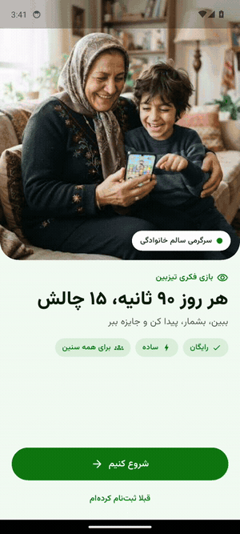

Captured on an Android emulator. The same codebase builds for iOS.

## Screenshots

| Welcome | Register | Home |
|---|---|---|
| 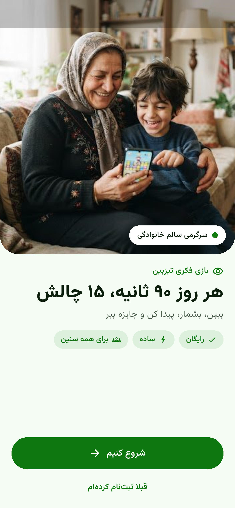 | 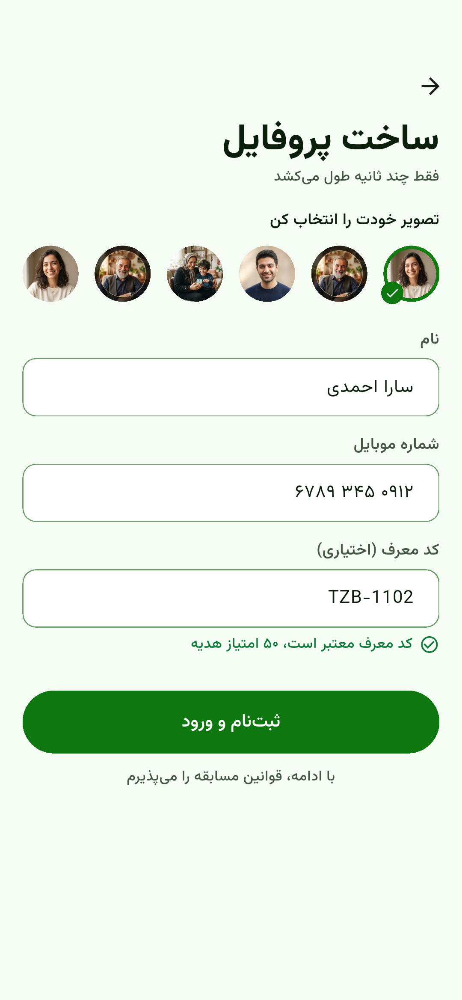 | 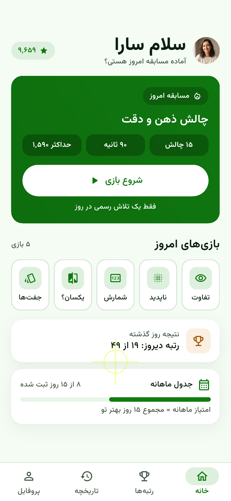 |

| Find the different one | Which one disappeared | Count the stars |
|---|---|---|
| 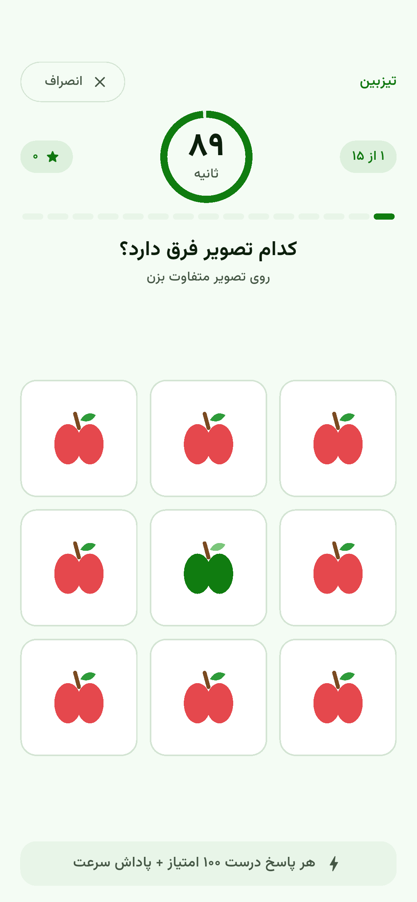 | 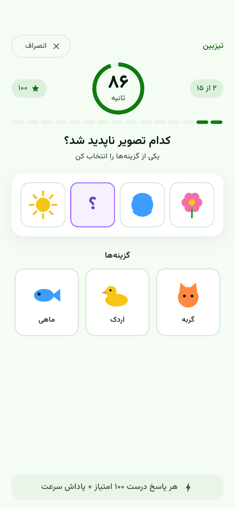 | 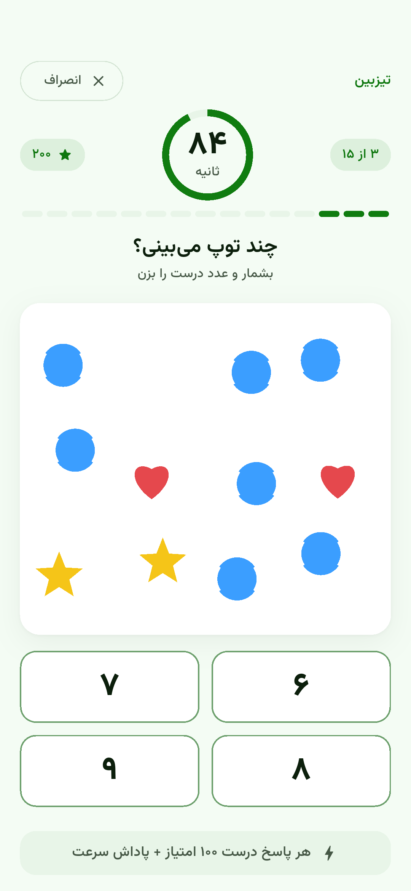 |

| Same or different | Match the pairs | Result |
|---|---|---|
| 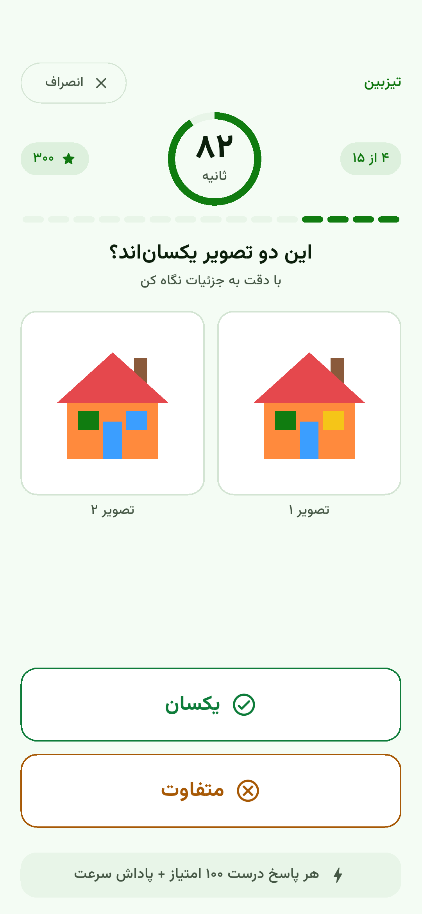 | 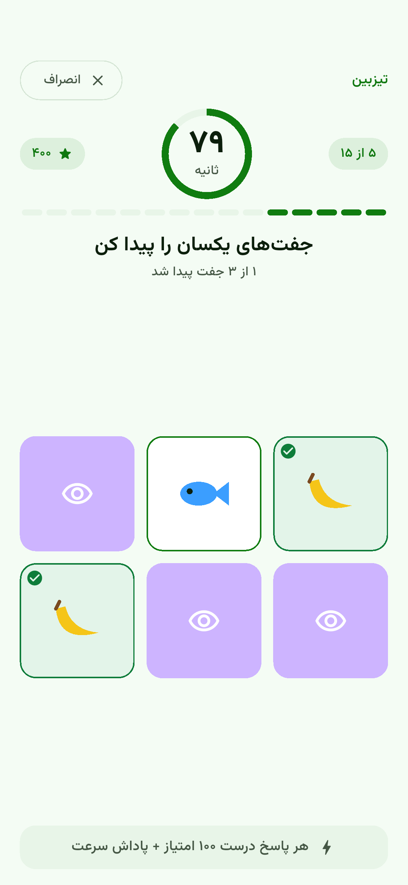 | 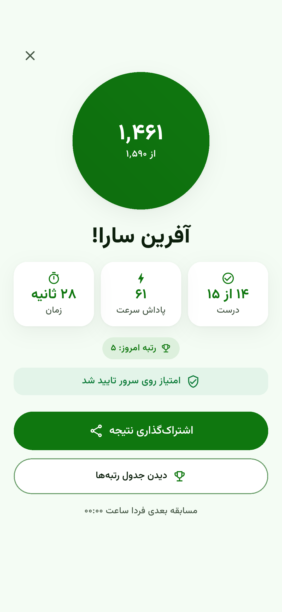 |

| Daily leaderboard | Monthly leaderboard | History |
|---|---|---|
| 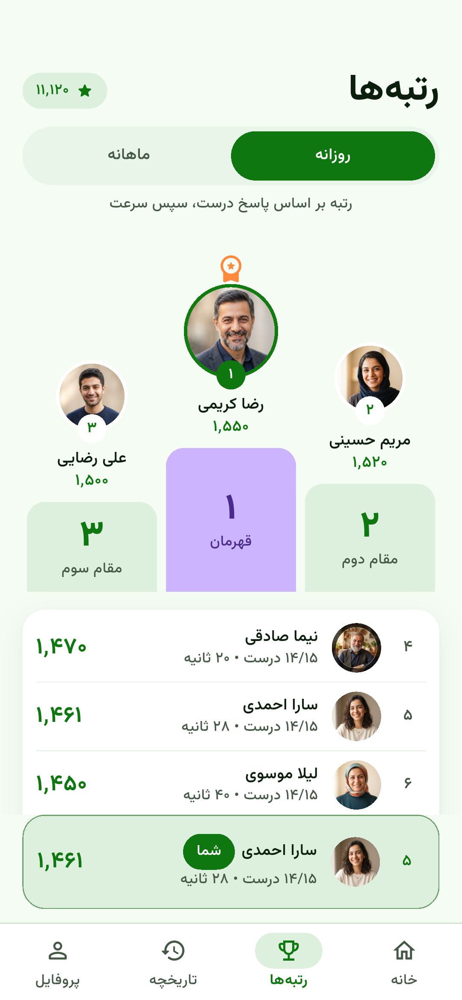 | 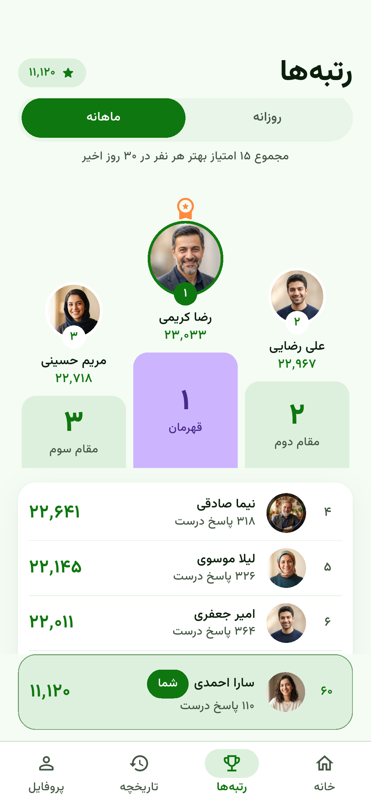 | 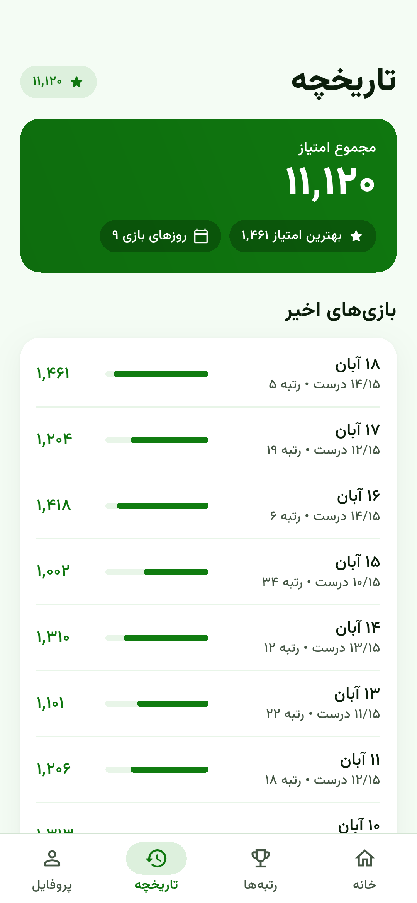 |

| Profile and referral | Admin review | Home after playing |
|---|---|---|
| 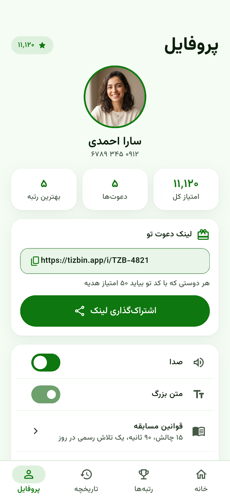 | 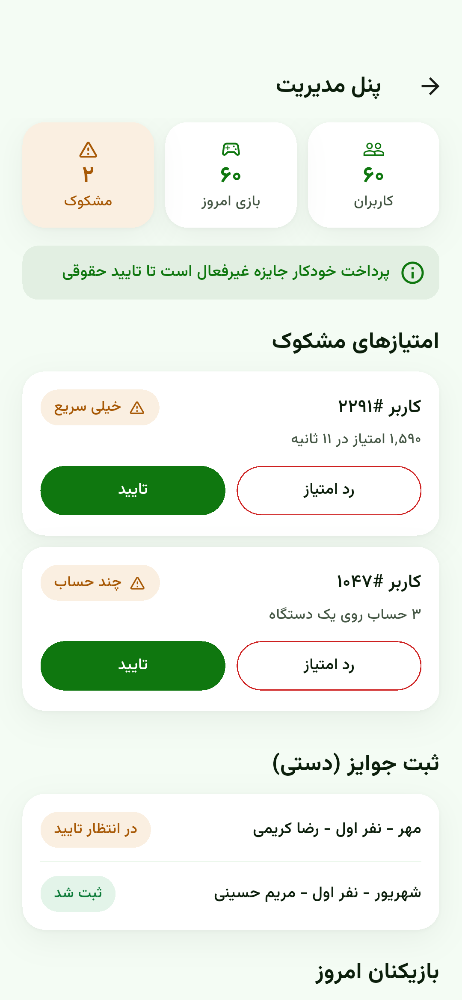 | 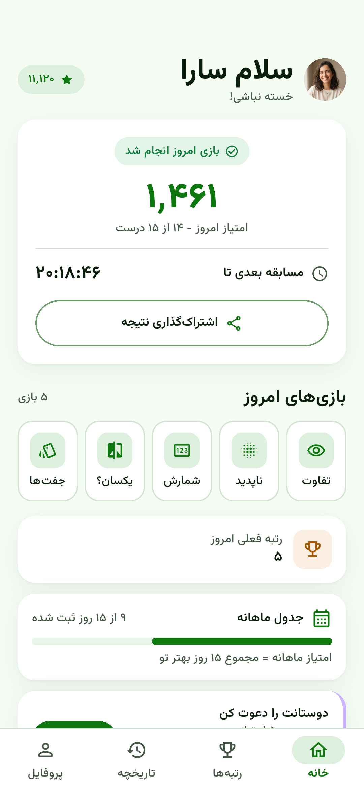 |

## What it shows

- **Easy registration**: pick a face, type a name and a mobile number, optional referral
  code checked on the spot.
- **Five games on one set of reusable parts**: find the different picture, remember which
  picture disappeared, count identical objects, same or different, match identical
  pictures. All pieces are flat shapes drawn in code, so the app ships no game images and
  downloads nothing to play.
- **Daily competition**: 15 challenges (each game three times), one 90-second clock that
  pauses during the short right/wrong flash, big answer buttons, instant feedback.
- **Scoring**: 100 points per right answer plus one bonus point per second left, maximum
  1,590. One official scored attempt per day.
- **Server-side validation (simulated)**: the client sends only its answer log. The server
  rebuilds the day's 15 challenges from a shared seed, re-scores them, drops answers after
  the 90 seconds, keeps one attempt per day and flags impossible speed or many accounts on
  one device for review.
- **Leaderboards**: daily (accuracy first, then speed) and monthly (sum of each player's best
  15 daily scores), with your own row pinned.
- **History and points**, **result sharing and referral links**.
- **Basic admin**: users and today's plays, flagged scores to approve or reject, and the
  manual prize record. Automatic payouts stay off until legal and payment compliance is
  confirmed.
- **Built for cheap phones and weak networks**: no network needed during play, a finished
  run waits in a small queue (a few hundred bytes) until it can be sent.

## Flow

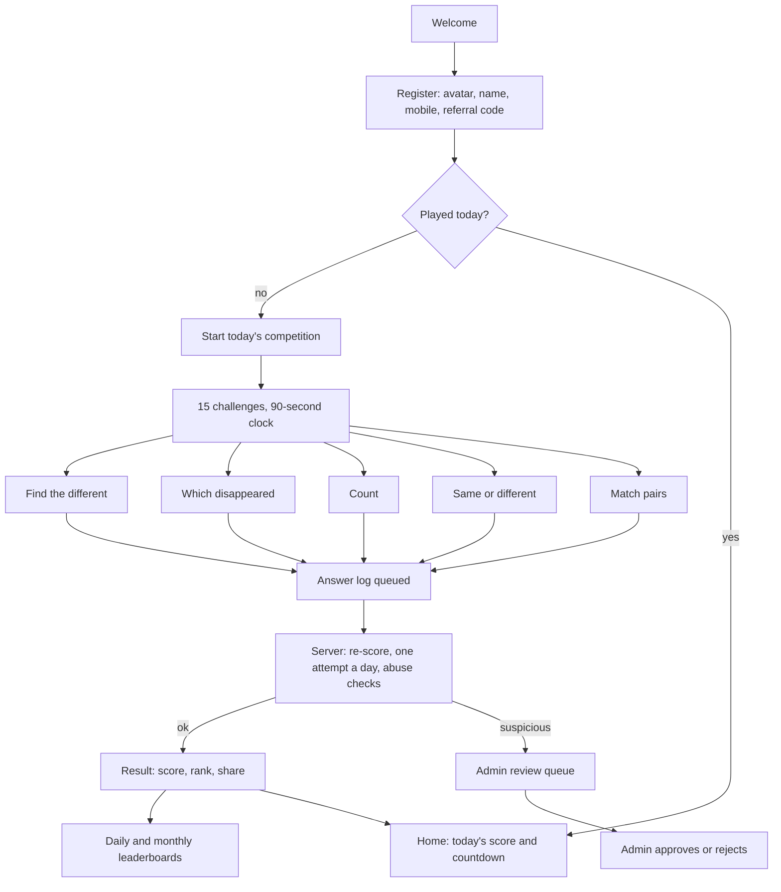

## Architecture

```
lib/
  domain/        models, seeded daily challenge generator, scoring rules (pure Dart)
  data/          ScoreServer (mock backend), SampleData, SubmissionQueue (offline)
  state/         Riverpod notifiers: session, daily run + clock, board mode, flags
  core/          design tokens, Persian digits and dates, shared widgets, piece painters
  features/      onboarding, home, game (5 boards + result), ranks, history, profile, admin
integration_test/  screenshot and demo walkthroughs used for the media above
design/          Stitch screens (HTML + PNG), design system and brief
```

- **State**: Riverpod 3 `Notifier`s. The daily run is one notifier with a 100 ms tick, so the
  clock, feedback and the match board stay in one immutable state object.
- **Backend boundary**: `ScoreServer` is the seam for Firebase (Cloud Functions + Firestore)
  or Supabase (Edge Function + Postgres). The client never sends a score, only answers and
  timings; the server derives the challenges from the day seed.
- **Data model for scale**: one row per player per day (`player_id, day, correct, time_ms,
  score`), unique on `(player_id, day)`. Daily ranks sort by `(correct desc, time_ms asc)`;
  the monthly board sums the top 15 rows per player.
- **RTL and type**: Persian locale, Vazirmatn (OFL) bundled, Persian digits and Jalali dates.
- **Tests**: 7 rule tests (scoring, seed, validation, time limit, abuse flag, ranking, offline
  queue) and 7 widget tests, including a full 15-challenge run.

## Run

```sh
flutter pub get
flutter run            # Android device or emulator
flutter test           # unit + widget tests
```

Requires Flutter 3.35 or newer.
